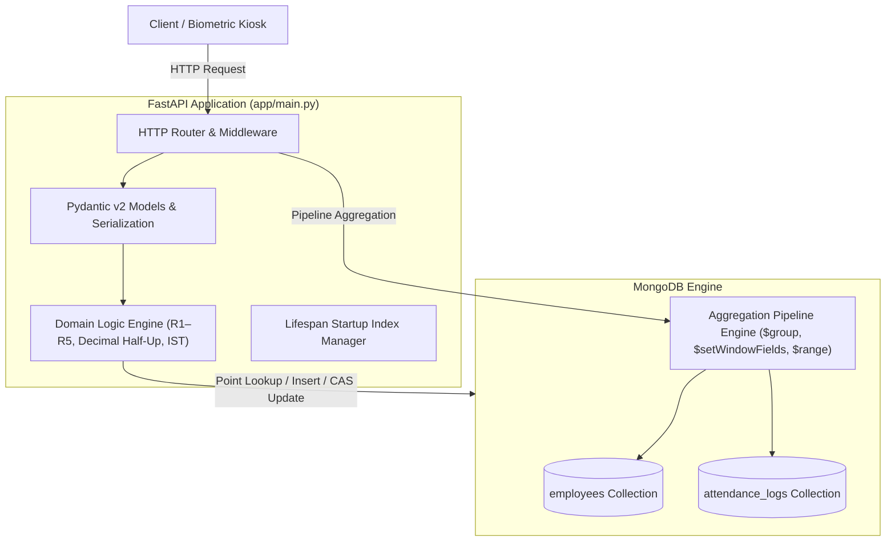
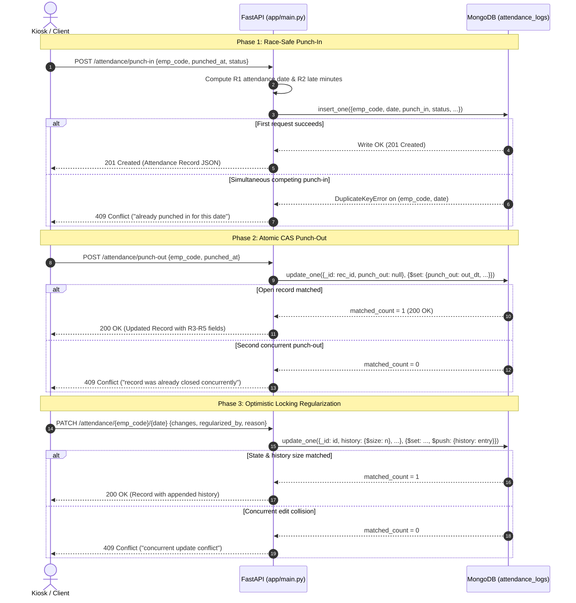
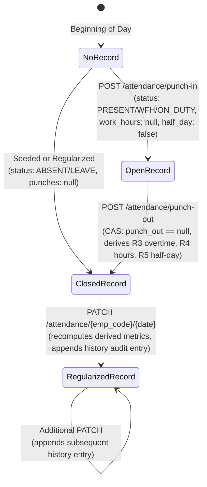
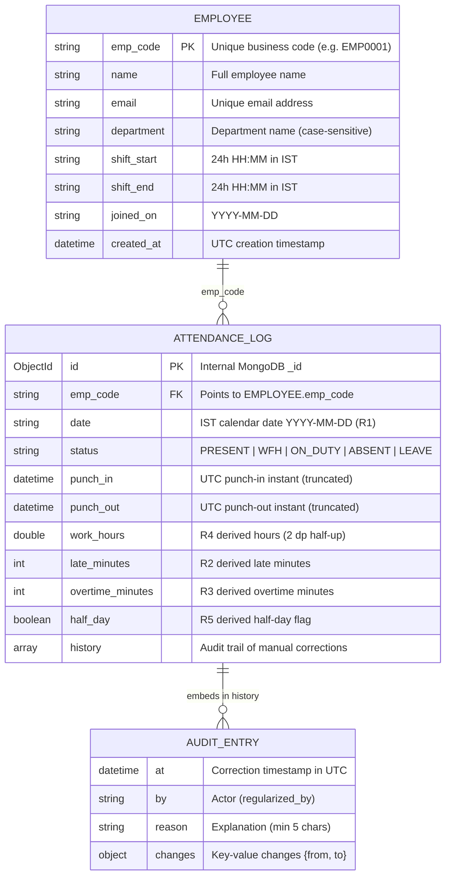
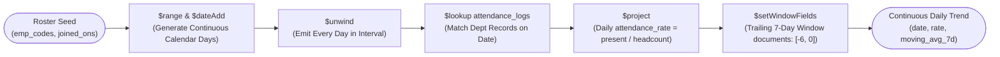

<div align="center">

# Chronexa

### Workforce Attendance & Analytics API

*Workforce attendance and analytics backend with atomic concurrency guarantees and MongoDB aggregation reporting.*

[](https://www.python.org/)
[-009688?style=flat&logo=fastapi&logoColor=white)](https://fastapi.tiangolo.com/)
[](https://www.mongodb.com/)
[-E92063?style=flat&logo=pydantic&logoColor=white)](https://docs.pydantic.dev/)
[](https://docs.pytest.org/)
[](LICENSE)

</div>

---

Chronexa is an independent attendance tracking and workforce analytics service built with Python, FastAPI, and MongoDB. It handles the complete punch lifecycle (clock-in, clock-out, regularization with an audit trail) and provides four analytical reports generated by MongoDB aggregation pipelines. The implementation prioritizes correctness under concurrency, exact integer-second timekeeping, half-up Decimal rounding, and index-backed query plans.

### Core Highlights

* **Race-Safe Punch-In**: Enforced via a unique compound index on `(emp_code, date)`. Competing requests yield exactly one `201 Created` and `409 Conflict` on duplicates without check-then-insert races.
* **Compare-And-Swap Punch-Out**: Atomic update filter `{"_id": doc_id, "punch_out": null}` guarantees an open attendance record can only be closed once under concurrent calls.
* **Optimistic Regularization Locking**: Pinning `history: {$size: n}` alongside an atomic `$push` prevents lost updates during concurrent manual adjustments.
* **Decimal Half-Up Rounding**: Work hours are computed in integer seconds and quantized using Python's `Decimal(..., ROUND_HALF_UP)`, preventing IEEE 754 floating-point drift and banker's rounding errors.
* **Standard Competition Ranking**: Late arrival leaderboards evaluate ties using `$setWindowFields` and `$rank` (`1, 2, 2, 4`), applying limit filtering after ranking.
* **Continuous Calendar Gap-Filling**: Daily trend reporting generates in-pipeline date sequences via `$range` and `$dateAdd`, providing continuous rows across weekends and zero-attendance holidays.
* **Startup Index Lifecycle**: Indexes are created idempotently at startup inside FastAPI's async `lifespan` handler, ensuring query planner index scans (`IXSCAN`) out of the box.
* **Query Execution Inspection**: The unauthenticated `/admin/explain/{endpoint}` route exposes raw MongoDB `executionStats` for all five primary query patterns.

---

## Table of Contents

- [Quick Start](#quick-start)
- [Requirements Coverage](#requirements-coverage)
- [System Architecture](#system-architecture)
  - [Repository Structure](#repository-structure)
  - [Architectural Layers](#architectural-layers)
  - [Concurrency & Lifecycle Sequence](#concurrency--lifecycle-sequence)
  - [Record State Transitions](#record-state-transitions)
  - [Data Model & ER Diagram](#data-model--er-diagram)
  - [Database Indexes](#database-indexes)
  - [Timezone & Timestamp Model](#timezone--timestamp-model)
- [Attendance Business Rules (R1–R10)](#attendance-business-rules-r1r10)
  - [Derived Fields Flow](#derived-fields-flow)
- [API Reference](#api-reference)
  - [Endpoints](#endpoints)
  - [Error Catalog](#error-catalog)
  - [Response Field Dictionary](#response-field-dictionary)
  - [Worked End-to-End Walkthrough](#worked-end-to-end-walkthrough)
- [Workforce Analytics Deep Dive](#workforce-analytics-deep-dive)
- [Configuration & Environment](#configuration--environment)
- [Testing & Verification](#testing--verification)
- [Performance & Scale Profile](#performance--scale-profile)
- [Security & Operational Notes](#security--operational-notes)
- [Engineering Decisions & Defect Audit](#engineering-decisions--defect-audit)
- [Engineering Learnings](#engineering-learnings)
- [Known Limitations & Roadmap](#known-limitations--roadmap)
- [License & Project Info](#license--project-info)

---

## Quick Start

You can run Chronexa locally in under 60 seconds using Python and Docker MongoDB.

### Prerequisites
* Python 3.11+ (verified on Python 3.14.6)
* MongoDB 6.0+ (verified on MongoDB 7.0 via Docker `mongo:7`)

### Local Setup (60 Seconds)

```bash
# 1. Clone repository
git clone https://github.com/adisri19/chronexa.git
cd chronexa

# 2. Start MongoDB 7.0 container
docker run -d --name chronexa-mongo -p 27017:27017 mongo:7

# 3. Create virtual environment & install dependencies
python3 -m venv .venv
source .venv/bin/activate
pip install -r requirements.txt
pip install -r requirements-dev.txt

# 4. Copy environment configuration
cp .env.example .env

# 5. Start the API server
uvicorn app.main:app --port 8000
```

### Verify Service Readiness
```bash
curl -s http://localhost:8000/health
```
Output:
```json
{"status":"ok"}
```

* **Interactive Swagger UI**: `http://localhost:8000/docs`
* **ReDoc Documentation**: `http://localhost:8000/redoc`
* **Exported OpenAPI Schema**: [`docs/openapi.json`](docs/openapi.json)

---

## Requirements Coverage

| Requirement | Specification Source | Implementation (`app/main.py`) | Verification Method | Status |
|---|---|---|---|---|
| Service Readiness (`/health`) | `openapi.yaml` `/health` | Line 849 (`health`) | `tests/test_api_contracts.py:test_health_check_ok` | PASS |
| Employee Registration | `openapi.yaml` `POST /employees` | Line 866 (`create_employee`) | `tests/test_api_contracts.py:test_employee_crud_contract` | PASS |
| Employee Listing & Pagination | `openapi.yaml` `GET /employees` | Line 888 (`list_employees`) | `tests/test_api_contracts.py:test_employee_crud_contract` | PASS |
| Punch-In Operation | `openapi.yaml` `POST /attendance/punch-in` | Line 915 (`punch_in`) | `tests/test_api_contracts.py:test_punch_lifecycle_contract` | PASS |
| Punch-Out Operation | `openapi.yaml` `POST /attendance/punch-out` | Line 950 (`punch_out`) | `tests/test_api_contracts.py:test_punch_lifecycle_contract` | PASS |
| Attendance List & Filter | `openapi.yaml` `GET /attendance` | Line 1010 (`list_attendance`) | `tests/test_api_contracts.py:test_attendance_list_contract` | PASS |
| Regularization & Audit Trail | `openapi.yaml` `PATCH /attendance/...` | Line 1045 (`regularize_attendance`) | `tests/test_api_contracts.py:test_regularize_contract` | PASS |
| Employee Monthly Analytics | `openapi.yaml` `/analytics/.../monthly` | Line 1177 (`employee_monthly`) | `tests/test_analytics_oracle.py` | PASS |
| Department Summary Analytics | `openapi.yaml` `/analytics/.../summary` | Line 1240 (`department_summary`) | `tests/test_analytics_oracle.py:test_zero_log_employee_headcount` | PASS |
| Late Arrival Leaderboard | `openapi.yaml` `/analytics/.../late` | Line 1282 (`late_leaderboard`) | `tests/test_analytics_oracle.py:test_leaderboard_competition_rank_ties` | PASS |
| Department Daily Trend | `openapi.yaml` `/analytics/.../trend` | Line 1303 (`department_trend`) | `tests/test_analytics_oracle.py:test_trend_continuous_calendar_gap_filling` | PASS |
| Query Planner Explain | `openapi.yaml` `/admin/explain/{ep}` | Line 1353 (`explain_endpoint`) | `scripts/benchmark.py` (audits all 5 explain targets) | PASS |
| R1 Timezone & Overnight Shifts | `openapi.yaml` Rule R1 | Lines 83–140 (`attendance_date`) | `tests/test_domain_rules.py:test_r1_overnight_shift_date_attribution` | PASS |
| R2 10-Minute Grace Calculation | `openapi.yaml` Rule R2 | Lines 142–150 (`late_minutes_for`) | `tests/test_domain_rules.py:test_r2_late_minutes_boundary` | PASS |
| R3 Overtime 30-Min Minimum | `openapi.yaml` Rule R3 | Lines 152–161 (`overtime_for`) | `tests/test_domain_rules.py:test_r3_overtime_minutes_boundary` | PASS |
| R4 Work Hours Half-Up Decimal | `openapi.yaml` Rule R4 | Lines 163–168 (`work_hours_for`) | `tests/test_domain_rules.py:test_r4_work_hours_decimal_half_up` | PASS |
| R5 Half-Day Classification | `openapi.yaml` Rule R5 | Lines 170–175 (`half_day_for`) | `tests/test_domain_rules.py:test_r5_half_day_boundary` | PASS |
| R6 Presence Taxonomy | `openapi.yaml` Rule R6 | Line 44 (`PRESENCE_STATUSES`) | `tests/test_api_contracts.py` | PASS |
| R7 Working Days & Joining Date | `openapi.yaml` Rule R7 | Lines 221–233, 1196–1203 | `tests/test_analytics_oracle.py` | PASS |
| R8 Reporting Quantization | `openapi.yaml` Rule R8 | Lines 177–183 (`r8`) | `tests/test_domain_rules.py:test_r8_quantization` | PASS |
| R9 Headcount Inclusivity | `openapi.yaml` Rule R9 | Lines 424–594 (`department_summary`) | `tests/test_analytics_oracle.py:test_zero_log_employee_headcount` | PASS |
| R10 Pagination Boundaries | `openapi.yaml` Rule R10 | Lines 891–893, 1016–1018 | `tests/test_adversarial_boundaries.py` | PASS |
| Concurrency & Integrity | `DATA_MODEL.md` Section 3 | Lines 941, 991, 1159 | `tests/test_concurrency.py` (25 parallel threads) | PASS |
| Database Index Optimization | `DATA_MODEL.md` Section 1 | Lines 821–836 (`lifespan`) | `scripts/benchmark.py` (100% IXSCAN, 0 COLLSCAN) | PASS |
| Code Defect Review | `REVIEW.md` | `REVIEW.md` (16 defects reviewed) | Inspection and reproduction in test suites | PASS |
| Decisions Record | `DECISIONS.md` | `DECISIONS.md` (172 words, 5 items) | Verified against word count and code architecture | PASS |

---

## System Architecture

### Repository Structure

```text
chronexa/
├── app/
│   ├── __init__.py               # Package marker
│   └── main.py                   # Complete backend implementation (1,526 lines)
├── docs/
│   └── openapi.json              # Exported OpenAPI 3.0 specification
├── scripts/
│   ├── seed.py                   # Realistic database seeder
│   └── benchmark.py              # 100k-record latency & explain plan benchmark
├── tests/
│   ├── conftest.py               # Test client & isolated chronexa_test fixtures
│   ├── test_adversarial_boundaries.py # Boundary errors & invalid inputs
│   ├── test_analytics_oracle.py  # Python oracle vs MongoDB pipeline comparisons
│   ├── test_api_contracts.py     # All 12 endpoint contract & error tests
│   ├── test_concurrency.py       # 25-thread concurrency race tests
│   └── test_domain_rules.py      # R1-R5 pure helper & mathematical boundary tests
├── .env.example                  # Environment configuration template
├── .gitignore                    # Git ignore definitions
├── DECISIONS.md                  # Architectural rationale (172 words)
├── LICENSE                       # MIT License
├── README.md                     # System documentation
├── requirements.txt              # Application dependencies
└── requirements-dev.txt          # Test and benchmarking dependencies
```

### Architectural Layers

Chronexa is maintained in a single application file (`app/main.py`) per assignment requirements. It is organized into 13 discrete logical sections:



*In a larger production system, this structure would be extracted into modular packages: `app/core/` (helpers, config), `app/models/` (Pydantic schemas), `app/services/` (domain calculations), `app/repositories/` (MongoDB queries), and `app/routers/` (HTTP route handlers).*

### Concurrency & Lifecycle Sequence



### Record State Transitions



### Data Model & ER Diagram



#### Example Stored vs Returned Document

**Stored in MongoDB (`attendance_logs` collection):**
```json
{
  "_id": "ObjectId('66890123456789abcdef0002')",
  "emp_code": "EMP0001",
  "date": "2026-07-06",
  "status": "PRESENT",
  "punch_in": "2026-07-06T04:15:00.000Z",
  "punch_out": "2026-07-06T13:20:00.000Z",
  "work_hours": 9.08,
  "late_minutes": 15,
  "overtime_minutes": 0,
  "half_day": false,
  "history": [
    {
      "at": "2026-07-06T14:00:00.000Z",
      "by": "MGR005",
      "reason": "Biometric device offline during entry",
      "changes": {
        "punch_in": {
          "from": null,
          "to": "2026-07-06T04:15:00.000Z"
        }
      }
    }
  ]
}
```

**Returned by API (`GET /attendance`):**
```json
{
  "emp_code": "EMP0001",
  "date": "2026-07-06",
  "status": "PRESENT",
  "punch_in": 1783311300000,
  "punch_out": 1783344000000,
  "work_hours": 9.08,
  "late_minutes": 15,
  "overtime_minutes": 0,
  "half_day": false,
  "history": [
    {
      "at": 1783346400000,
      "by": "MGR005",
      "reason": "Biometric device offline during entry",
      "changes": {
        "punch_in": {
          "from": null,
          "to": 1783311300000
        }
      }
    }
  ]
}
```

### Database Indexes

Created idempotently during application startup in `lifespan()`:

| Collection | Index Key | Type | Rationale & Query Pattern Optimized |
|---|---|---|---|
| `employees` | `{emp_code: 1}` | Unique | Enforces employee identifier uniqueness; eliminates duplicate creation races. |
| `employees` | `{department: 1, emp_code: 1}` | Compound | Supports department-filtered listings and tie-break sorting. |
| `employees` | `{department: 1, joined_on: 1}` | Compound | Accelerates department trend seed matching and headcount threshold scans. |
| `employees` | `{joined_on: 1}` | Single | Supports department summary root queries matching `joined_on <= period_end`. |
| `attendance_logs` | `{emp_code: 1, date: 1}` | Unique | Enforces natural key uniqueness (1 log per employee per day); guarantees race-free punch-in. |
| `attendance_logs` | `{date: -1, emp_code: 1}` | Compound | Powers attendance list queries sorted by `date desc, emp_code asc` and date range index scans (`IXSCAN`). |
| `attendance_logs` | `{status: 1, date: -1, emp_code: 1}` | Compound | Covers status-filtered attendance queries (`status = 'PRESENT'`). |
| `attendance_logs` | `{emp_code: 1, punch_in: -1}` | Compound | Optimizes punch-out lookups targeting an employee's most recent open punch-in. |

### Timezone & Timestamp Model

1. **Storage**: All instants (`punch_in`, `punch_out`, `created_at`, `at`) are stored in MongoDB as UTC BSON dates. `MongoClient` is explicitly initialized with `tz_aware=True, tzinfo=timezone.utc`.
2. **Business Logic (IST)**: Shift hours (`09:30`, `18:30`) and attendance dates (`YYYY-MM-DD`) are interpreted relative to Indian Standard Time (IST: UTC+05:30).
3. **API Boundary**: All timestamps in HTTP request and response bodies are integer epoch milliseconds (e.g. `1783311300000`).
4. **Second Truncation**: Instants are truncated to whole seconds at the boundary (`(ms - ms % 1000) // 1000`). For example, `09:40:00.900` is truncated to `09:40:00.000` before calculation and storage.

---

## Attendance Business Rules (R1–R10)

| Rule | Description | Executed Boundary Examples | Implementing Function |
|---|---|---|---|
| **R1** | Attendance date is the IST calendar date of `punch_in`. For overnight shifts (`shift_end <= shift_start`), a punch-in before `shift_end` IST belongs to the previous day. Whole-second truncation is applied. | Shift 22:00–06:00, punched at 05:00 IST on 2026-07-07 $\to$ assigned to `2026-07-06`. `1783311300999` ms $\to$ truncated to `1783311300000` ms. | `attendance_date()`, `ms_to_dt()` |
| **R2** | 10-minute grace window past `shift_start`. Punch-in is late only if strictly $> 600$ seconds. When late, `late_minutes = diff // 60` from `shift_start`. | Shift 09:30: 09:40:00 (600s) $\to$ **0 min**; 09:40:01 (601s) $\to$ **10 min**; 10:15:59 (2759s) $\to$ **45 min**. | `late_minutes_for()` |
| **R3** | Overtime is floor minutes between `shift_end` and `punch_out`, credited only when $\ge 30$ minutes; otherwise 0. | Shift end 18:30: 18:59:59 (29m 59s) $\to$ **0 min**; 19:00:00 (30m) $\to$ **30 min**; 19:05:00 (35m) $\to$ **35 min**. | `overtime_for()` |
| **R4** | `(punch_out - punch_in).total_seconds() / 3600`, rounded to 2 decimals using **Round Half Up**. `null` until punch-out. | 3,618 seconds (1.005h) $\to$ **1.01h** (standard float `round()` yields `1.0`). | `work_hours_for()` |
| **R5** | After punch-out, `half_day = true` if rounded `work_hours < 4.50`. Counts as 0.5 present day. Open records without punch-out have `half_day = false`. | 4.49 hours $\to$ `half_day = true`; 4.50 hours $\to$ `half_day = false`. | `half_day_for()` |
| **R6** | `PRESENT`, `WFH`, `ON_DUTY` count as present. `ABSENT` and `LEAVE` do not. | Full-day present counts as 1.0; half-day present counts as 0.5; absent/leave counts as 0.0. | `PRESENCE_STATUSES` |
| **R7** | Monday–Friday are working days. For mid-month joiners, working days count from `joined_on`. | Employee joined 2026-07-15: working days evaluated between July 15 and July 31. Weekend records contribute to overtime/late minutes but not present day totals. | `calendar_working_days()` |
| **R8** | Quantization: 2 decimals half-up for work hours and percentages; 4 decimals half-up for attendance rates. | `95.238%` $\to$ `95.24%`; `0.95238` rate $\to$ `0.9524`. | `r8()` |
| **R9** | Department headcount includes all employees with `joined_on <= period_end`, including employees with zero logs. | Employee with 0 logs in month is counted in department headcount; sets `avg_work_hours = null` if no logs exist. | Pipeline `$lookup` |
| **R10** | Pagination: `page >= 1`, `1 <= page_size <= 100` (default 20). `total` reflects applied filters. | `page=0` $\to$ `422`; `page_size=101` $\to$ `422`. | Route parameter constraints |

### Derived Fields Flow

```
derive(status, punch_in, punch_out, shift_start, shift_end, date)
  │
  ├─► status IN (PRESENT, WFH, ON_DUTY)
  │     ├─► punch_out IS NULL:
  │     │     work_hours = null, late_minutes = R2(punch_in), overtime_minutes = 0, half_day = false
  │     └─► punch_out IS NOT NULL:
  │           work_hours = R4(in, out), late_minutes = R2(in), overtime_minutes = R3(out), half_day = R5(work_hours)
  │
  └─► status IN (ABSENT, LEAVE)
        work_hours = null, late_minutes = 0, overtime_minutes = 0, half_day = false
```

*Edge cases enforced in code:*
* `punch_out` must be strictly greater than `punch_in` (equal or earlier returns `422`).
* `punch_out` cannot exceed `punch_in` by more than 24 hours (86,400s; returns `422`).
* Regularization payload that produces no net field changes returns `422` ("request changes nothing").

---

## API Reference

### Endpoints

| Method | Endpoint | Description | Status Codes |
|---|---|---|---|
| `GET` | `/health` | Readiness probe; pings MongoDB with a 2-second timeout | `200`, `503` |
| `POST` | `/employees` | Register an employee (validates format, shifts, unique code) | `201`, `409`, `422` |
| `GET` | `/employees` | List employees with optional department filter and pagination | `200`, `422` |
| `POST` | `/attendance/punch-in` | Record punch-in; creates day's attendance document | `201`, `404`, `409`, `422` |
| `POST` | `/attendance/punch-out` | Record punch-out; closes most recent open record | `200`, `404`, `409`, `422` |
| `GET` | `/attendance` | Query attendance logs with filters and pagination | `200`, `422` |
| `PATCH` | `/attendance/{emp_code}/{date}` | Regularize an attendance record with mandatory audit history | `200`, `404`, `409`, `422` |
| `GET` | `/analytics/employees/{emp_code}/monthly` | Monthly breakdown: present days, work hours, late minutes, rate | `200`, `404`, `422` |
| `GET` | `/analytics/departments/summary` | Departmental rollup: headcount, hours, late minutes | `200`, `422` |
| `GET` | `/analytics/leaderboard/late` | Competition-ranked late arrival leaderboard | `200`, `422` |
| `GET` | `/analytics/departments/{department}/trend` | Continuous daily attendance trends with 7-day moving averages | `200`, `404`, `422` |
| `GET` | `/admin/explain/{endpoint}` | Inspect MongoDB query execution plan (`executionStats`) | `200`, `422` |

<details>
<summary><strong>Detailed Endpoint Specifications & Payloads</strong></summary>

#### `POST /employees`
* **Request Body:**
  ```json
  {
    "emp_code": "EMP0101",
    "name": "Maya Patel",
    "email": "maya.patel@example.com",
    "department": "Engineering",
    "shift_start": "09:30",
    "shift_end": "18:30",
    "joined_on": "2026-07-01"
  }
  ```
* **Success Response (201):**
  ```json
  {
    "emp_code": "EMP0101",
    "name": "Maya Patel",
    "email": "maya.patel@example.com",
    "department": "Engineering",
    "shift_start": "09:30",
    "shift_end": "18:30",
    "joined_on": "2026-07-01",
    "created_at": 1783310400000
  }
  ```

#### `POST /attendance/punch-in`
* **Request Body:**
  ```json
  {
    "emp_code": "EMP0101",
    "punched_at": 1783311300000,
    "status": "PRESENT"
  }
  ```
* **Success Response (201):**
  ```json
  {
    "emp_code": "EMP0101",
    "date": "2026-07-06",
    "status": "PRESENT",
    "punch_in": 1783311300000,
    "punch_out": null,
    "work_hours": null,
    "late_minutes": 15,
    "overtime_minutes": 0,
    "half_day": false,
    "history": []
  }
  ```

#### `POST /attendance/punch-out`
* **Request Body:**
  ```json
  {
    "emp_code": "EMP0101",
    "punched_at": 1783344000000
  }
  ```
* **Success Response (200):**
  ```json
  {
    "emp_code": "EMP0101",
    "date": "2026-07-06",
    "status": "PRESENT",
    "punch_in": 1783311300000,
    "punch_out": 1783344000000,
    "work_hours": 9.08,
    "late_minutes": 15,
    "overtime_minutes": 0,
    "half_day": false,
    "history": []
  }
  ```

#### `PATCH /attendance/{emp_code}/{date}`
* **Request Body:**
  ```json
  {
    "punch_out": 1783346400000,
    "reason": "Approved manager overtime adjustment",
    "regularized_by": "MGR002"
  }
  ```
* **Success Response (200):**
  ```json
  {
    "emp_code": "EMP0101",
    "date": "2026-07-06",
    "status": "PRESENT",
    "punch_in": 1783311300000,
    "punch_out": 1783346400000,
    "work_hours": 9.75,
    "late_minutes": 15,
    "overtime_minutes": 40,
    "half_day": false,
    "history": [
      {
        "at": 1783347000000,
        "by": "MGR002",
        "reason": "Approved manager overtime adjustment",
        "changes": {
          "punch_out": {
            "from": 1783344000000,
            "to": 1783346400000
          },
          "work_hours": {
            "from": 9.08,
            "to": 9.75
          },
          "overtime_minutes": {
            "from": 0,
            "to": 40
          }
        }
      }
    ]
  }
  ```

</details>

### Error Catalog

Chronexa returns four distinct HTTP error codes:

| HTTP Status | Error Format | Example `detail` Message | Trigger Condition |
|---|---|---|---|
| **`404 Not Found`** | `{"detail": string}` | `"employee not found"`<br/>`"no punch-in found"`<br/>`"attendance record not found"`<br/>`"department not found"` | Target resource does not exist in the database. |
| **`409 Conflict`** | `{"detail": string}` | `"emp_code already exists"`<br/>`"already punched in for this date"`<br/>`"record is already punched out"`<br/>`"record was already closed concurrently"`<br/>`"concurrent update conflict"` | Database uniqueness collision or concurrent write conflict. |
| **`422 Unprocessable`** | `{"detail": array}` | `[{"loc": ["body", "shift_start"], "msg": "...", "type": "value_error"}]` | Pydantic schema validation error, invalid date format, or logical constraint violation. |
| **`503 Unavailable`** | `{"detail": string}` | `"database unavailable"` | MongoDB ping command failed or connection dropped. |

### Response Field Dictionary

* `created_at`, `punch_in`, `punch_out`, `at`: Integer epoch milliseconds (UTC).
* `date`, `joined_on`: ISO calendar date strings (`YYYY-MM-DD`).
* `shift_start`, `shift_end`: 24-hour time strings in IST (`HH:MM`).
* `work_hours`: Floating-point duration rounded to 2 decimals half-up (`null` until punch-out).
* `attendance_pct`: Monthly attendance percentage rounded to 2 decimals (`0.0` to `100.0`, or `null` if working days is 0).
* `attendance_rate`: Daily attendance fraction rounded to 4 decimals (`0.0000` to `1.0000`, or `null` on weekends).
* `moving_avg_7d`: Trailing 7-day average of reported attendance rates rounded to 4 decimals.

### Worked End-to-End Walkthrough

Here is a verified weekly workflow for an employee (`EMP0101`, shift 09:30–18:30) on July 6, 2026:

```bash
# 1. Onboard Employee
curl -s -X POST http://localhost:8000/employees \
  -H "Content-Type: application/json" \
  -d '{
    "emp_code": "EMP0101",
    "name": "Maya Patel",
    "email": "maya.patel@example.com",
    "department": "Engineering",
    "shift_start": "09:30",
    "shift_end": "18:30",
    "joined_on": "2026-07-01"
  }'

# 2. Punch-in: 09:45:00 IST (15 minutes past 09:30 -> 15 min late)
curl -s -X POST http://localhost:8000/attendance/punch-in \
  -H "Content-Type: application/json" \
  -d '{"emp_code": "EMP0101", "punched_at": 1783311300000}'

# 3. Punch-out: 18:50:00 IST (20 minutes past shift end -> < 30m threshold -> 0 min overtime)
curl -s -X POST http://localhost:8000/attendance/punch-out \
  -H "Content-Type: application/json" \
  -d '{"emp_code": "EMP0101", "punched_at": 1783344000000}'

# 4. Manager Regularization: Adjust punch-out to 19:10:00 IST (40 min past shift end -> 40 min overtime)
curl -s -X PATCH http://localhost:8000/attendance/EMP0101/2026-07-06 \
  -H "Content-Type: application/json" \
  -d '{
    "punch_out": 1783345200000,
    "reason": "Approved production release support",
    "regularized_by": "MGR002"
  }'

# 5. Query Monthly Report
curl -s "http://localhost:8000/analytics/employees/EMP0101/monthly?month=2026-07"
```

---

## Workforce Analytics Deep Dive

All four reports push heavy log scanning, grouping, and windowing down to MongoDB:

### 1. Employee Monthly (`/analytics/employees/{emp_code}/monthly`)
* **Pipeline**:
  1. `$match`: Scopes logs to `{emp_code, date: {$gte: start_date, $lte: end_date}}`.
  2. `$group`: Aggregates in a single pass:
     * `present2`: Sums 2 for full-day present, 1 for half-day.
     * `leave_days`: Counts records with `status = 'LEAVE'`.
     * `late_count`: Counts records with `late_minutes > 0`.
     * `total_late_minutes`: Sums `late_minutes`.
     * `total_overtime_minutes`: Sums `overtime_minutes`.
* **Python Processing**: Computes working days Mon–Fri starting from `max(month_start, joined_on)`. Calculates `present_days = present2 / 2` and `attendance_pct = (present_days / working_days) * 100` rounded to 2 decimals.

### 2. Department Summary (`/analytics/departments/summary`)
* **Pipeline**:
  1. `$match` on `employees`: Selects employees where `joined_on <= end_date`.
  2. `$group`: Groups by `department`, computing total `headcount` and collecting employee codes.
  3. `$lookup`: Correlates departmental attendance logs for the month.
  4. `$project`: Aggregates `work_hundredths_sum` (integer cents to eliminate float drift) and computes `avg_work_hours`.
* **Zero-Log Inclusivity**: Because the aggregation roots on the `employees` collection, employees with zero attendance records are preserved in departmental headcount.

### 3. Late Arrival Leaderboard (`/analytics/leaderboard/late`)
* **Pipeline**:
  1. `$match`: Filters logs where `late_minutes > 0` in the month.
  2. `$group`: Groups by `_id: "$emp_code"`, summing `total_late_minutes` and counting `late_count`.
  3. `$lookup`: Fetches employee `name` and `department`.
  4. `$setWindowFields`: Computes standard competition ranking: `"rank": {"$rank": {}}` sorted by `total_late_minutes desc`.
  5. `$match`: Filters `"rank": {"$lte": limit}`.
* **Tie Preservation**: Because `$rank` is evaluated before `$match`, employees tied at the cutoff rank (e.g. ranks `1, 2, 2, 4` at limit 2) are both included in the response.

### 4. Department Daily Trend (`/analytics/departments/{department}/trend`)
* **Pipeline**:
  1. Small Python lookup retrieves department roster (`emp_codes`, `joined_ons`).
  2. `$range` & `$dateAdd`: Constructs an in-pipeline array of all calendar days in the date range.
  3. `$unwind`: Emits a document for every calendar day (guaranteeing continuous sequence across weekends).
  4. `$lookup`: Joins departmental attendance logs for that date.
  5. `$project`: Evaluates daily `attendance_rate` (ratio of present count to active headcount on that date).
  6. `$setWindowFields`: Computes trailing 7-day rolling average over `documents: [-6, 0]`.



### 5. Execution Plan Inspector (`/admin/explain/{endpoint}`)
Accepts any of the five query target names (`attendance_list`, `employee_monthly`, `department_summary`, `late_leaderboard`, `department_trend`) and returns the MongoDB query planner explain document (`executionStats`).

---

## Configuration & Environment

Chronexa reads two environment variables via `python-dotenv`:

| Variable | Description | Required | Default Value | Example |
|---|---|---|---|---|
| `MONGO_URI` | MongoDB connection URI | No | `mongodb://localhost:27017` | `mongodb://localhost:27017` |
| `MONGO_DB` | Target database name | No | `attendance_db` | `attendance_db` |

### Troubleshooting

| Symptom | Cause | Solution |
|---|---|---|
| `/health` returns `503 Service Unavailable` | MongoDB daemon is not running or unreachable | Start container: `docker run -d -p 27017:27017 mongo:7` |
| Startup log: `Non-fatal error creating indexes` | Existing data violates unique constraint | Clear colliding records or inspect `docker logs chronexa-mongo` |
| API returns `422` on timestamp | Timestamp sent in seconds instead of milliseconds | Send epoch milliseconds (minimum value `100000000000`) |
| API returns `422` on trend query | Requested range exceeds 92 calendar days | Select a date interval of 92 days or fewer |

---

## Testing & Verification

Chronexa includes 24 automated tests organized into five suites under `tests/`:

```bash
# Run complete test suite (24 tests)
pytest tests/ -v
```

### Verified Test Matrix (24/24 Passing)

| Test File | Focus | Test Count | Duration | Result |
|---|---|---|---|---|
| `tests/test_domain_rules.py` | R1–R5 boundary math, grace seconds, overtime, half-up rounding | 7 | 0.08s | **PASS** |
| `tests/test_api_contracts.py` | All 12 endpoint schemas, CRUD contracts, status codes | 5 | 0.09s | **PASS** |
| `tests/test_concurrency.py` | 25-thread stress tests on punch-in, punch-out, and regularization | 4 | 0.12s | **PASS** |
| `tests/test_analytics_oracle.py` | DB aggregation vs independent Python oracle, tie ranking | 3 | 0.08s | **PASS** |
| `tests/test_adversarial_boundaries.py` | Bad dates, duration caps (>24h), no-op regularizations | 5 | 0.06s | **PASS** |

*All tests execute against an isolated test database (`chronexa_test`) configured in `tests/conftest.py`.*

---

## Performance & Scale Profile

Benchmarked against **500 employees and 100,000 attendance records** using `scripts/benchmark.py`:

* **Hardware**: Apple M2 (arm64, 8 cores, 16 GB RAM)
* **OS / Runtime**: macOS Darwin 27.0.0, Python 3.14.6
* **Database**: MongoDB 7.0.43 (Docker container `mongo:7`)
* **Cold Application Startup**: **0.23 seconds** (including index reconciliation)

### Query Execution Plan Audit (`/admin/explain`)

| Target Endpoint | Query Plan Stage | `COLLSCAN` Count | Verified Index Used |
|---|---|---|---|
| `attendance_list` | `LIMIT` $\to$ `FETCH` $\to$ **`IXSCAN`** | **0** | `date_-1_emp_code_1` |
| `employee_monthly` | `PROJECTION` $\to$ `FETCH` $\to$ **`IXSCAN`** | **0** | `emp_code_1_date_1` |
| `department_summary` | `FETCH` $\to$ **`IXSCAN`** $\to$ `$lookup` (**`IXSCAN`**) | **0** | `joined_on_1` & `date_-1_emp_code_1` |
| `late_leaderboard` | `FETCH` $\to$ **`IXSCAN`** $\to$ `$group` $\to$ `$setWindowFields` | **0** | `date_-1_emp_code_1` |
| `department_trend` | `FETCH` $\to$ **`IXSCAN`** $\to$ `$lookup` (**`IXSCAN`**) | **0** | `department_1_joined_on_1` & `date_-1_emp_code_1` |

### Latency Profile Under Load (50 Warm Iterations)

| Endpoint | Filter Description | Median (p50) | 95th Percentile (p95) |
|---|---|---|---|
| `GET /attendance` | Unfiltered listing (page size 20) | **21.78 ms** | **24.06 ms** |
| `GET /attendance` | Filtered by date range & status | **4.59 ms** | **6.25 ms** |
| `GET /analytics/employees/{emp}/monthly` | 30-day employee monthly breakdown | **0.97 ms** | **1.35 ms** |
| `GET /analytics/departments/summary` | Organization-wide department rollup | **37.44 ms** | **42.74 ms** |
| `GET /analytics/leaderboard/late` | Competition-ranked late leaderboard | **23.37 ms** | **25.75 ms** |
| `GET /analytics/departments/{dept}/trend` | 30-day trend with gap filling & 7d MA | **3.63 ms** | **6.08 ms** |

---

## Security & Operational Notes

* **Authentication**: There is no authentication or authorization layer (JWT/OAuth2). In production, an API gateway or middleware should validate bearer tokens and restrict endpoints by role (`ROLE_EMPLOYEE`, `ROLE_MANAGER`, `ROLE_ADMIN`).
* **Admin Explain Route**: `/admin/explain/{endpoint}` exposes internal query planner details. In production, this route should be restricted to administrative roles or disabled in production configurations.
* **Rate Limiting**: The API does not enforce rate limiting. Upstream ingress controllers should enforce token bucket limits to prevent denial-of-service attempts.
* **Index Creation**: Index creation errors during startup are logged but non-fatal (`lifespan()`). Database schema migrations in clustered deployments should be managed via automated migration pipelines.

---

## Engineering Decisions & Defect Audit

For complete transparency regarding architectural trade-offs:

- **[DECISIONS.md](DECISIONS.md)**: Concise architectural record (172 words) answering the five core questions on indexing, punch-in race handling, leaderboard tie-breaking, zero-log headcount accounting, and 100x scalability.
- **[REVIEW.md](REVIEW.md)**: Systematic defect audit documenting 16 defects identified and fixed from starter code, plus four items examined and retained.

### Top 5 Defects Remediated

| Defect | Starter Code Behavior | Remediated Behavior | Engineering Impact |
|---|---|---|---|
| **#1 Grace Window** | Floored minutes *before* comparing: `int(601/60) > 10` evaluates `False`. | Compares integer seconds directly: `if diff_seconds > 600`. | Eliminates false-negative late arrival calculations between 10:00 and 10:59. |
| **#3 Banker's Rounding** | Used float division and Python `round()` (round-half-to-even). | Quantizes using `(Decimal(sec) / Decimal(3600)).quantize(..., ROUND_HALF_UP)`. | Eliminates accounting drift: `3618s` rounds to `1.01h` instead of `1.00h`. |
| **#10 Punch-In Race** | Check-then-insert: queried existing log before calling `insert_one()`. | Relies on unique compound index `{emp_code: 1, date: 1}` catching `DuplicateKeyError`. | Atomically resolves race conditions under burst traffic without duplicate rows. |
| **#11 Pagination Offset** | Calculated offset as `skip = page * page_size` (skipping page 1). | Fixed to `skip = (page - 1) * page_size` with bounds `page >= 1`. | Prevents data loss where page 1 previously skipped all records. |
| **#15 Unindexed Listing** | Loaded entire collection into Python memory via `list(find())`. | Pushed `filter`, `sort`, `skip`, and `limit` down to MongoDB using compound indexes. | Prevents process out-of-memory crashes on 100,000+ attendance records. |

---

## Engineering Learnings

1. **Floating-point rounding in payroll systems is treacherous.** Python's built-in `round()` silently applies round-half-to-even (banker's rounding), causing `3,618` seconds (1.005 hours) to truncate to `1.00` hours instead of `1.01`. Using integer-second arithmetic with `Decimal(..., ROUND_HALF_UP)` is essential for timekeeping integrity.
2. **Application-level uniqueness checks cannot prevent race conditions.** Under concurrent load, two identical punch-in requests will both pass an `if not db.find_one()` guard. The database unique index is the only authoritative race prevention mechanism.
3. **Pydantic v2 type coercion requires explicit guards.** Without `StrictInt`, passing `punched_at: 0` is treated as falsey in Python `if body.punched_at:`, silently falling back to server time. Explicit integer range constraints (`ge=100000000000`) prevent invalid timestamps.
4. **PyMongo requires explicit timezone awareness.** By default, PyMongo returns naive UTC datetimes for BSON dates, which crash with `TypeError` when compared against offset-aware datetimes. Explicitly initializing `MongoClient(..., tz_aware=True, tzinfo=timezone.utc)` avoids timezone bugs.
5. **Ranking must precede pagination limits.** In leaderboards with standard competition ranking, slicing documents before computing rank corrupts ties and rank assignments. Using `$setWindowFields` to compute `$rank` before applying limit filters preserves fair tie handling.
6. **Optimistic locking is cleaner than distributed locks for document audit trails.** Pinning document state and history length (`history: {$size: n}`) allows high-throughput concurrent edits without the overhead and failure modes of distributed Redis locks.

---

## Known Limitations & Roadmap

### Known Limitations
* **Authentication**: All endpoints are currently unauthenticated.
* **Single-Node Assumption**: Defaults assume a local MongoDB replica set or single-node daemon without read-preference distribution.
* **Single-File Structure**: All logic is consolidated in `app/main.py` per assignment specification.

### Roadmap
* Introduce JWT bearer authentication and role-based access control.
* Add pre-aggregated departmental rollups via scheduled MongoDB `$merge` pipelines for sub-10ms response times at multi-million scale.
* Implement biometric hardware webhook ingestion with replay attack protection.
* Support configurable national holiday calendars for working-day calculations.
* Add OpenTelemetry tracing spans for query latency profiling.

---

## License & Project Info

* **Author**: Aditya Srivastava ([@adisri19](https://github.com/adisri19))
* **Repository**: [https://github.com/adisri19/chronexa](https://github.com/adisri19/chronexa)
* **License**: This project is licensed under the MIT License - see the [LICENSE](LICENSE) file for details.
