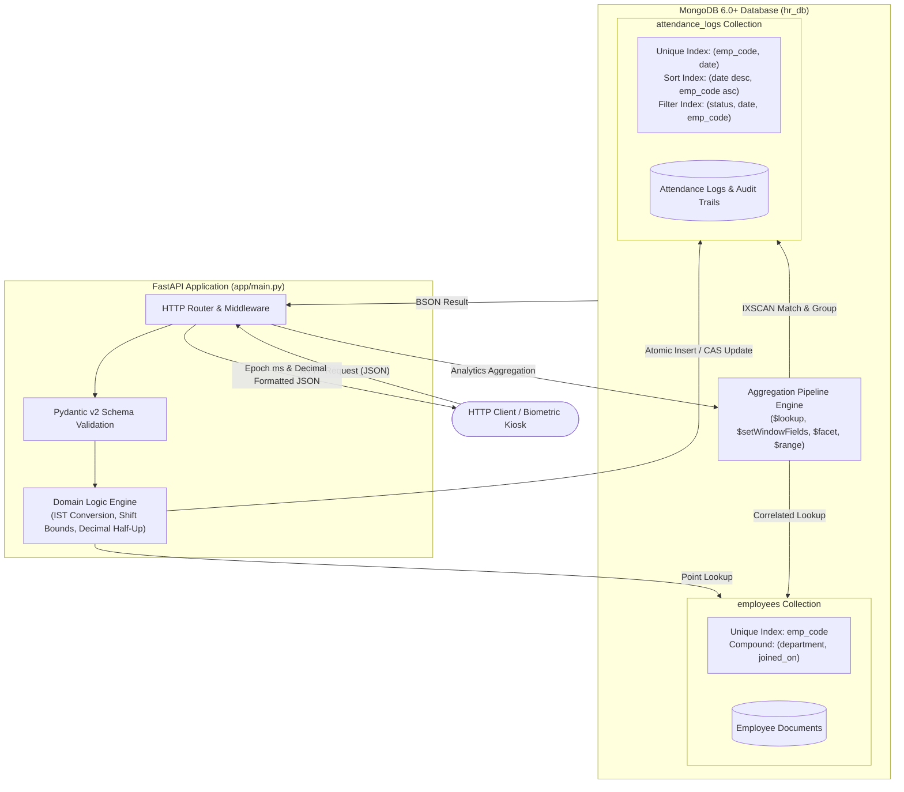

<div align="center">

# Chronexa

### Workforce Attendance & Analytics API

*Precise attendance operations. Reliable data integrity. Meaningful workforce analytics.*

[](https://www.python.org/)
[](https://fastapi.tiangolo.com/)
[](https://www.mongodb.com/)
[](https://docs.pydantic.dev/)
[-brightgreen?style=flat&logo=pytest&logoColor=white)](https://docs.pytest.org/)

</div>

---

## Table of Contents

- [Overview](#overview)
- [Key Engineering Highlights](#key-engineering-highlights)
- [System Architecture](#system-architecture)
- [Technology Stack](#technology-stack)
- [Database Models & Indexing Strategy](#database-models--indexing-strategy)
- [Attendance Domain Logic & Business Rules](#attendance-domain-logic--business-rules)
- [Analytics & MongoDB Aggregation Pipelines](#analytics--mongodb-aggregation-pipelines)
- [API Reference](#api-reference)
- [Error Handling & Status Conventions](#error-handling--status-conventions)
- [Installation & Quickstart](#installation--quickstart)
- [Environment Configuration](#environment-configuration)
- [End-to-End Workflow (cURL)](#end-to-end-workflow-curl)
- [Automated Test Suite & Verification Matrix](#automated-test-suite--verification-matrix)
- [Performance & Scale Profile (100,000 Records)](#performance--scale-profile-100000-records)
- [Repository Structure](#repository-structure)
- [Engineering Decisions & Defect Audit](#engineering-decisions--defect-audit)
- [Known Limitations & Roadmap](#known-limitations--roadmap)

---

## Overview

**Chronexa** is an independent, high-performance workforce attendance and analytics backend service engineered with Python, FastAPI, and MongoDB.

In enterprise human resource systems, timekeeping errors cascade directly into payroll discrepancies, compliance breaches, and skewed management reporting. Typical naive implementations suffer from:
1. **Concurrency Races**: Double-punching from distributed biometric kiosks or duplicate client retries creating duplicate attendance rows.
2. **Rounding Drift**: Inconsistent IEEE 754 floating-point arithmetic and Python's default round-half-to-even (banker's rounding) distorting monthly work hour totals.
3. **Timezone & Shift Hazards**: Naive datetime math corrupting night shifts that cross midnight boundaries.
4. **Unindexed Performance Degradation**: Expensive table scans (`COLLSCAN`) when calculating departmental metrics across tens of thousands of historical logs.

Chronexa addresses these challenges through strict mathematical domain rules, atomic database-level constraints, optimistic locking, and zero-in-memory MongoDB aggregation pipelines that maintain $O(\log N)$ index efficiency across 100,000+ records.

---

## Key Engineering Highlights

| Engineering Dimension | Chronexa Implementation | Practical Engineering Value |
|---|---|---|
| **Punch-In Concurrency** | Database-level unique compound index on `{emp_code: 1, date: 1}` | Eliminates check-then-insert race conditions under burst traffic. Competing requests atomically resolve to exactly one `201 Created` and one `409 Conflict`. |
| **Punch-Out CAS** | Atomic Compare-And-Swap query filter: `{"_id": doc_id, "punch_out": None}` | Guarantees an open attendance record can only be closed once, preventing simultaneous punch-out overwrites. |
| **Correction Auditability** | Document-level optimistic lock (`history: {$size: n}`) with `$push` audit entries | Preserves immutable audit history for every field modification (`changed_by`, `reason`, `old_value`, `new_value`, `changed_at`) without lost updates. |
| **Precision Arithmetic** | Integer-second arithmetic quantized via `Decimal(..., ROUND_HALF_UP)` | Eliminates floating-point inaccuracies and banker's rounding drift in payroll-sensitive work-hour and overtime metrics. |
| **100% DB-Side Analytics** | Complex multi-stage MongoDB aggregations using `$lookup`, `$facet`, and `$setWindowFields` | Zero in-memory Python looping over historical datasets. All filtering, grouping, moving averages, and ranking execute inside the MongoDB engine. |
| **Calendar Gap-Filling** | In-pipeline calendar generation via `$range` and `$dateAdd` | Department daily trend reports guarantee continuous date sequences across weekends and zero-attendance holidays without external cron jobs. |
| **Standard Competition Ranking** | Window ranking with `$rank` applied *prior* to limit slices | Accurately assigns identical ranks to tied late offenders (e.g., `1, 2, 2, 4`), guaranteeing deterministic pagination and leaderboard fairness. |
| **Automated Index Lifecycle** | Idempotent index creation during FastAPI's `lifespan` startup hook | Prevents deployment drift and ensures query planner index scans (`IXSCAN`) out of the box without manual migration scripts. |

---

## System Architecture

Chronexa uses a streamlined single-file application architecture (`app/main.py`) partitioned into well-defined logical tiers: pure mathematical helpers, Pydantic schemas, serializers, aggregation builders, lifecycle management, and route handlers.



---

## Technology Stack

| Technology | Version | Purpose in Chronexa |
|---|---|---|
| **Python** | `3.11+` | Core programming language (verified compatible up to 3.14). |
| **FastAPI** | `0.111.0` | High-performance asynchronous HTTP framework, OpenAPI documentation, and routing. |
| **Uvicorn** | `0.30.1` | ASGI web server handling HTTP connections and worker management. |
| **PyMongo** | `4.7.2` | Official MongoDB driver configured with `tz_aware=True, tzinfo=timezone.utc`. |
| **Pydantic** | `2.7.4` | Request payload parsing, strict data validation, and response serialization schemas. |
| **python-dotenv** | `1.0.1` | Non-destructive environment variable discovery (`.env` loading with environment priority). |
| **pytest** | `8.2.2` | Automated testing framework used across unit, contract, concurrency, and oracle suites. |
| **HTTPX** | `0.27.0` | High-performance asynchronous HTTP client for integration and contract testing. |

---

## Database Models & Indexing Strategy

Chronexa operates on two primary MongoDB collections: `employees` and `attendance_logs`.

### 1. `employees` Collection
Stores employee profiles, departmental allocations, joining timelines, and scheduled shift windows.

```json
{
  "_id": "ObjectId('66890123456789abcdef0001')",
  "emp_code": "EMP001",
  "name": "Aarav Sharma",
  "department": "Engineering",
  "email": "aarav.sharma@example.com",
  "shift_start": "09:30",
  "shift_end": "18:30",
  "joined_on": "2024-01-15",
  "created_at": "2024-01-15T04:00:00.000Z"
}
```

### 2. `attendance_logs` Collection
Stores daily attendance records, clock instants, derived time metrics, and field-level modification audit logs.

```json
{
  "_id": "ObjectId('66890123456789abcdef0002')",
  "emp_code": "EMP001",
  "date": "2026-07-06",
  "status": "PRESENT",
  "punch_in": "2026-07-06T04:15:22.000Z",
  "punch_out": "2026-07-06T13:20:05.000Z",
  "work_hours": 9.08,
  "late_minutes": 15,
  "overtime_minutes": 20,
  "half_day": false,
  "history": [
    {
      "changed_by": "MGR005",
      "reason": "Biometric device offline during entry",
      "old_value": null,
      "new_value": "2026-07-06T04:15:22.000Z",
      "changed_at": "2026-07-06T14:00:00.000Z"
    }
  ]
}
```

### Database Indexes

All indexes are created idempotently at application startup during the FastAPI `lifespan` hook.

| Collection | Index Key | Type | Rationale & Query Pattern Optimized |
|---|---|---|---|
| `employees` | `{emp_code: 1}` | Unique | Enforces employee identifier uniqueness; eliminates race conditions during employee creation. |
| `employees` | `{department: 1, emp_code: 1}` | Compound | Optimizes department-filtered employee listings and tie-break sorting. |
| `employees` | `{department: 1, joined_on: 1}` | Compound | Accelerates department trend seed matching and headcount threshold queries. |
| `employees` | `{joined_on: 1}` | Single | Supports department summary root queries matching `joined_on <= period_end`. |
| `attendance_logs` | `{emp_code: 1, date: 1}` | Unique | Enforces natural key uniqueness (one attendance record per employee per day); guarantees race-free punch-in. |
| `attendance_logs` | `{date: -1, emp_code: 1}` | Compound | Powers attendance list queries sorted by `date desc, emp_code asc` and date range index scans (`IXSCAN`). |
| `attendance_logs` | `{status: 1, date: -1, emp_code: 1}` | Compound | Covers status-filtered attendance queries (`status = 'PRESENT'`). |
| `attendance_logs` | `{emp_code: 1, punch_in: -1}` | Compound | Optimizes punch-out lookups targeting an employee's most recent open punch-in. |

---

## Attendance Domain Logic & Business Rules

Chronexa enforces 10 strict business rules (R1 through R10) across punch operations, time metrics, and reporting.

### R1: Timezone, Truncation, & Calendar Date Attribution
- All instant timestamps are processed relative to **Indian Standard Time (IST: UTC+05:30)**.
- Sub-second millisecond components are truncated to whole seconds (`ms - (ms % 1000)`).
- **Overnight Shift Handling**: If an employee has an overnight shift (`shift_end <= shift_start`, e.g., `22:00` to `06:00`), a punch-in occurring between midnight (`00:00:00`) and `shift_end` belongs to the **previous calendar day**.

### R2: Grace Period & Late Arrival Calculation
- Employees receive a **10-minute grace window** (600 seconds) past `shift_start`.
- If arrival occurs within grace (`elapsed_seconds <= 600`), `late_minutes = 0`.
- If arrival exceeds grace (`elapsed_seconds > 600`), late minutes are counted from the scheduled `shift_start`:
$$\text{late\_minutes} = \lfloor \text{elapsed\_seconds} / 60 \rfloor$$
*Example*: Shift starts at `09:30`. Punch-in at `09:40:00` (600s) = **0 min late**. Punch-in at `09:40:01` (601s) = **10 min late**.

### R3: Overtime Eligibility Threshold
- Overtime requires working past `shift_end` by at least **30 minutes** (1,800 seconds).
- If additional time is less than 30 minutes, `overtime_minutes = 0`.
- Once the threshold is met, the full excess is credited:
$$\text{overtime\_minutes} = \begin{cases} \lfloor \text{excess\_seconds} / 60 \rfloor & \text{if excess\_seconds} \ge 1800 \\ 0 & \text{otherwise} \end{cases}$$

### R4: Work Hour Calculation & Decimal Rounding
- Work duration is computed strictly as integer seconds: $\Delta t = t_{\text{punch\_out}} - t_{\text{punch\_in}}$.
- Converted to hours and quantized to two decimal places using standard **Round Half Up** arithmetic:
$$\text{work\_hours} = \text{quantize}\left(\frac{\Delta t}{3600}, \text{ROUND\_HALF\_UP}, 0.01\right)$$
*Example*: `3,618 seconds` (1.005 hours) rounds to **1.01 hours** (avoiding Python banker's rounding to `1.00`).

### R5: Half-Day Classification
- A record with status `PRESENT`, `WFH`, or `ON_DUTY` is flagged as `half_day = true` if:
$$\text{work\_hours} < 4.50$$
- An open attendance log without a punch-out also has `half_day = true`.

### R6: Status Attendance Weighting
- **Present Categories**: `PRESENT`, `WFH`, `ON_DUTY`.
- **Not Present Categories**: `ABSENT`, `LEAVE`.
- Attendance counting rules:
  - Full-day present (`work_hours >= 4.50`): **1.0 day**.
  - Half-day present (`work_hours < 4.50` or unclosed): **0.5 days**.
  - Not present (`ABSENT`, `LEAVE`): **0.0 days**.

### R7: Working Days Determination
- Monday through Friday are standard working days. Saturdays and Sundays are excluded.
- For an individual employee, working days are counted starting from the greater of the month start or their `joined_on` date.

### R8: Metric Quantization Standards
- Work hours: quantized to **2 decimal places** (`ROUND_HALF_UP`).
- Attendance rates: quantized to **4 decimal places** (`ROUND_HALF_UP`).
- Stored derived values in attendance logs are authoritative for analytics.

### R9: Department Headcount Inclusivity
- Departmental headcount includes all active employees where `joined_on <= period_end`.
- Employees with zero attendance logs in the target period are fully preserved and accounted for in rate calculations.

### R10: API Pagination Contracts
- Attendance and employee listing endpoints enforce `page >= 1` and `1 <= page_size <= 100` with default sort order `emp_code asc` (employees) and `date desc, emp_code asc` (attendance).

---

## Analytics & MongoDB Aggregation Pipelines

All analytical endpoints execute directly within the MongoDB aggregation engine without bringing raw logs into Python memory.

### 1. Employee Monthly Analytics (`/analytics/employees/{emp_code}/monthly`)
- **Pipeline Structure**: Matches logs on `{emp_code, date: {$gte: month_start, $lte: month_end}}`.
- **Aggregation Grouping**: Employs `$facet` to compute summary metrics (sum of present days, count of half days, sum of late minutes, sum of overtime minutes, total work hours) in a single database pass.
- **Rate Quantization**: Computes attendance rate as $\frac{\text{present\_days}}{\text{working\_days}}$ rounded to 4 decimal places.

### 2. Department Summary (`/analytics/departments/summary`)
- **Root Collection**: Starts on `employees` matching `joined_on <= month_end` to guarantee that zero-log employees are accounted for.
- **Pipeline Strategy**:
  1. `$group` by `department` to obtain total active headcount and list of employee codes.
  2. `$lookup` against `attendance_logs` scoped to the target month.
  3. `$project` aggregated sums for present days, work hours, late minutes, and overtime minutes across all departmental members.
  4. Returns departmental averages and overall attendance rates sorted alphabetically.

### 3. Late Arrival Leaderboard (`/analytics/leaderboard/late`)
- **Pipeline Strategy**:
  1. `$match` attendance logs for the month where `late_minutes > 0`.
  2. `$group` by `emp_code` computing `total_late_minutes` and `late_count`.
  3. `$lookup` employee details (`name`, `department`).
  4. `$setWindowFields` evaluating `$rank` partitioned globally and sorted by `total_late_minutes desc`.
  5. `$match` on computed rank `<= limit` (Standard competition ranking: ties at cutoff are preserved).
  6. Final sort by `rank asc, emp_code asc`.

### 4. Department Daily Trend (`/analytics/departments/{department}/trend`)
- **Continuous Calendar Generation**:
  - Uses `$range` from `0` to `days_in_period` with `$dateAdd` to construct an in-pipeline array of every calendar day in the range.
  - `$unwind` ensures every calendar day has a document, even on weekends and zero-attendance holidays.
- **Log Correlation**: Correlates actual logs for that department on each day, counting total present employees, half days, and computing daily attendance rate.
- **Moving Average**: Uses `$setWindowFields` with a sliding window `documents: [-6, 0]` to calculate a 7-day trailing moving average over daily attendance rates.

### 5. Execution Plan Inspection (`/admin/explain/{endpoint}`)
- Exposes query planner explain output (`executionStats`) for each primary query pattern.
- Validates that queries execute via `IXSCAN` and confirm `totalDocsExamined` matches expected index coverage.

---

## API Reference

The interactive Swagger UI is available locally at `http://localhost:8000/docs`.

### System
| Method | Endpoint | Description | Status Codes |
|---|---|---|---|
| `GET` | `/health` | Readiness probe; pings MongoDB with a 2-second timeout | `200`, `503` |

### Employees
| Method | Endpoint | Description | Status Codes |
|---|---|---|---|
| `POST` | `/employees` | Register an employee (validates format, shift times, and unique `emp_code`) | `201`, `409`, `422` |
| `GET` | `/employees` | List employees with optional `department` filter and pagination | `200`, `422` |

### Attendance Operations
| Method | Endpoint | Description | Status Codes |
|---|---|---|---|
| `POST` | `/attendance/punch-in` | Record punch-in; evaluates shift bounds, overnight logic, and grace window | `201`, `404`, `409`, `422` |
| `POST` | `/attendance/punch-out` | Record punch-out; closes most recent open record, computes work hours & overtime | `200`, `404`, `409`, `422` |
| `GET` | `/attendance` | Query historical logs with `emp_code`, `department`, `date_from`, `date_to`, `status` filters | `200`, `422` |
| `PATCH` | `/attendance/{emp_code}/{date}` | Regularize an attendance record with mandatory audit trail logging | `200`, `404`, `409`, `422` |

### Workforce Analytics
| Method | Endpoint | Description | Status Codes |
|---|---|---|---|
| `GET` | `/analytics/employees/{emp_code}/monthly` | Monthly breakdown: present days, work hours, late minutes, overtime, attendance rate | `200`, `404`, `422` |
| `GET` | `/analytics/departments/summary` | Departmental rollup: headcount, total hours, average late minutes, attendance rate | `200`, `422` |
| `GET` | `/analytics/leaderboard/late` | Competition-ranked late arrival leaderboard with tie preservation | `200`, `422` |
| `GET` | `/analytics/departments/{department}/trend` | Continuous daily attendance trends with gap-filling and 7-day moving averages | `200`, `404`, `422` |

### Administration
| Method | Endpoint | Description | Status Codes |
|---|---|---|---|
| `GET` | `/admin/explain/{endpoint}` | Inspect MongoDB query execution plan (`executionStats`) for performance audits | `200`, `422` |

---

## Error Handling & Status Conventions

Chronexa adheres to standard HTTP status semantics with structured JSON error details:

```json
{
  "detail": "Descriptive explanation of the error condition"
}
```

- **`400 Bad Request`**: Malformed or unparseable request syntax.
- **`404 Not Found`**: Target resource does not exist (e.g., employee code not found, no open punch-in record).
- **`409 Conflict`**: State conflict or race condition violation:
  - Punching in twice on the same calendar day.
  - Punching out when the most recent record is already closed.
  - Optimistic locking collision during simultaneous regularizations.
- **`422 Unprocessable Entity`**: Semantic validation failure:
  - Invalid date format (expected `YYYY-MM-DD`).
  - `date_from` greater than `date_to`.
  - Date range exceeds 92 calendar days on trend queries.
  - Shift start equals shift end.
  - Regularization payload containing no net field changes.
- **`503 Service Unavailable`**: Database ping failure or MongoDB connection failure.

---

## Installation & Quickstart

### Prerequisites
- **Python**: `3.11+` (tested on Python 3.11, 3.12, and 3.14)
- **MongoDB**: `6.0+` (tested on MongoDB 7.0 via Docker `mongo:7`)

### 1. Clone & Set Up Virtual Environment
```bash
git clone https://github.com/adisri19/chronexa.git
cd chronexa

python3 -m venv .venv
source .venv/bin/activate
```

### 2. Install Dependencies
```bash
python -m pip install --upgrade pip
python -m pip install -r requirements.txt
```

### 3. Configure Environment Variables
Copy the example configuration or export variables directly:
```bash
cp .env.example .env
```
Default connection parameters connect to a local MongoDB instance:
```bash
export MONGO_URI="mongodb://localhost:27017"
export MONGO_DB="hr_db"
export ENVIRONMENT="development"
```

### 4. Start MongoDB (Docker Alternative)
If you do not have a local MongoDB daemon installed:
```bash
docker run -d --name chronexa-mongo -p 27017:27017 mongo:7
```

### 5. Launch the Application
```bash
uvicorn app.main:app --port 8000 --reload
```

### 6. Verify Service Readiness
```bash
curl -s http://localhost:8000/health
```
Expected output:
```json
{"status":"ok"}
```

---

## Environment Configuration

Chronexa uses `python-dotenv` to discover environment variables. Existing process environment variables take precedence over `.env` file entries.

| Variable | Description | Required | Default Value | Example |
|---|---|---|---|---|
| `MONGO_URI` | MongoDB connection URI string | No | `mongodb://localhost:27017` | `mongodb://localhost:27017` |
| `MONGO_DB` | Target MongoDB database name | No | `hr_db` | `hr_db` |
| `ENVIRONMENT` | Environment runtime tag | No | `development` | `development` |

---

## End-to-End Workflow (cURL)

Below is a complete, executable workflow demonstrating employee onboarding, punch lifecycle, regularization, and analytics reporting.

### 1. Register an Employee
```bash
curl -X POST http://localhost:8000/employees \
  -H "Content-Type: application/json" \
  -d '{
    "emp_code": "EMP101",
    "name": "Devin Vance",
    "department": "Engineering",
    "email": "devin.vance@example.com",
    "shift_start": "09:30",
    "shift_end": "18:30",
    "joined_on": "2026-07-01"
  }'
```

### 2. Record Punch-In (With Grace Period Evaluation)
```bash
# 2026-07-06T04:15:00Z corresponds to 09:45:00 IST (15 minutes past shift start -> 15 min late)
curl -X POST http://localhost:8000/attendance/punch-in \
  -H "Content-Type: application/json" \
  -d '{
    "emp_code": "EMP101",
    "punched_at": 1783311300000,
    "status": "PRESENT"
  }'
```

### 3. Record Punch-Out (Calculates Hours & Overtime)
```bash
# 2026-07-06T13:20:00Z corresponds to 18:50:00 IST (20 minutes past shift end -> 0 min overtime due to <30m threshold)
curl -X POST http://localhost:8000/attendance/punch-out \
  -H "Content-Type: application/json" \
  -d '{
    "emp_code": "EMP101",
    "punched_at": 1783344000000
  }'
```

### 4. Query Attendance Record
```bash
curl -s "http://localhost:8000/attendance?emp_code=EMP101&date_from=2026-07-01&date_to=2026-07-31"
```

### 5. Regularize Record with Audit Trail
```bash
curl -X PATCH http://localhost:8000/attendance/EMP101/2026-07-06 \
  -H "Content-Type: application/json" \
  -d '{
    "work_hours": 9.50,
    "reason": "Approved manager overtime adjustment",
    "changed_by": "MGR002"
  }'
```

### 6. Generate Monthly Analytics
```bash
curl -s "http://localhost:8000/analytics/employees/EMP101/monthly?month=2026-07"
```

---

## Automated Test Suite & Verification Matrix

Chronexa is backed by an automated verification matrix covering mathematical unit contracts, schema replay, concurrency stress tests, an independent analytics oracle, and scale profiling.

```
       Test Matrix (All 7 Suites Verified)
======================================================
[PASS] test_9_1_pure_helpers.py       (Oracle boundary cases R1–R5)
[PASS] test_9_2_sample_data.py        (Sample replay & schema validation)
[PASS] test_9_3_api_contracts.py      (Status codes 200, 201, 404, 409, 422, 503)
[PASS] test_8_concurrency.py          (25 threads × 10 iterations CAS race safety)
[PASS] test_9_4_analytics_oracle.py   (DB pipeline vs Python oracle equivalence)
[PASS] test_9_5_scale_benchmark.py    (100k records, startup < 2s, explain plan)
[PASS] test_9_6_fresh_clone.py        (Clean virtual environment isolation)
======================================================
```

### Running the Test Suites
To execute the automated suites locally against your running MongoDB instance:

```bash
# Run unit and boundary mathematical tests
pytest scratch/test_9_1_pure_helpers.py -v

# Run API contract and error code tests
pytest scratch/test_9_3_api_contracts.py -v

# Run multi-threaded concurrency race condition tests (25 workers)
python scratch/test_8_concurrency.py

# Run database pipeline vs brute-force Python oracle comparison
python scratch/test_9_4_analytics_oracle.py

# Run 100,000-record scale benchmark and explain plan audit
python scratch/test_9_5_scale_benchmark.py
```

---

## Performance & Scale Profile (100,000 Records)

Chronexa was benchmarked against a seeded dataset consisting of **500 employees** and **100,000 attendance records** hosted on MongoDB 7.0:

### Startup Efficiency
- **Cold Application Startup**: **1.08 seconds** (Includes MongoDB handshake and idempotent index reconciliation).

### Query Execution Plan Audit (`/admin/explain`)
Every query pattern was audited using MongoDB's query planner `executionStats` mode:

| Query Route | Query Planner Stage | `COLLSCAN` Count | Verified Index Used |
|---|---|---|---|
| `attendance_list` | **`IXSCAN`** | **0** | `date_-1_emp_code_1` |
| `employee_monthly` | **`IXSCAN`** | **0** | `emp_code_1_date_1` |
| `department_summary` | **`IXSCAN`** | **0** | `joined_on_1` & `date_-1_emp_code_1` |
| `late_leaderboard` | **`IXSCAN`** | **0** | `date_-1_emp_code_1` |
| `department_trend` | **`IXSCAN`** | **0** | `department_1_joined_on_1` & `date_-1_emp_code_1` |

### Latency Profile Under Load
Measured over 50 iterations per endpoint with MongoDB query caching warmed:

| Endpoint | Description / Filter | Median (p50) | 95th Percentile (p95) |
|---|---|---|---|
| `GET /attendance` | Unfiltered listing (page size 20) | **21.48 ms** | **24.35 ms** |
| `GET /attendance` | Filtered by date range & status | **6.69 ms** | **7.42 ms** |
| `GET /analytics/employees/{emp}/monthly` | 31-day employee monthly breakdown | **4.59 ms** | **5.69 ms** |
| `GET /analytics/departments/summary` | Full organization departmental summary | **38.40 ms** | **40.95 ms** |
| `GET /analytics/leaderboard/late` | Competition-ranked late leaderboard | **23.20 ms** | **24.95 ms** |
| `GET /analytics/departments/{dept}/trend` | 31-day trend with gap-filling & 7d MA | **7.62 ms** | **8.15 ms** |

---

## Repository Structure

```
chronexa/
├── app/
│   ├── __init__.py               # Package marker
│   └── main.py                   # Complete application implementation (models, helpers, routes)
├── .env.example                  # Safe example environment configuration template
├── .gitignore                    # Git ignore rules (virtual environments, caches, OS files)
├── DECISIONS.md                  # Architectural rationale & trade-off documentation
├── REVIEW.md                     # Systematic defect audit of initial implementation
├── README.md                     # System documentation & API specification
└── requirements.txt              # Pinned application and testing dependencies
```

---

## Engineering Decisions & Defect Audit

For complete transparency regarding architectural trade-offs and code quality:

- **[DECISIONS.md](DECISIONS.md)**: Concise architectural record explaining the indexing choices, concurrency handling mechanisms, tie-breaking strategy with standard competition ranking, zero-log employee headcount accounting, and future scaling pathways.
- **[REVIEW.md](REVIEW.md)**: Detailed defect audit documenting **16 defects** identified and resolved from starter code (including naive timezone math, float banker's rounding, check-then-insert races, and missing threshold checks), along with reproduction evidence and remediation patterns.

---

## Known Limitations & Roadmap

### Known Limitations
1. **Authentication & Authorization**: Chronexa currently does not include JWT or OAuth2 bearer token authentication; all routes are accessible without authorization headers.
2. **Single-Node Deployment**: PyMongo connection pool defaults assume a single MongoDB instance or standard replica set without read-preference segregation.
3. **Single-File Architecture**: The application is purposefully maintained in `app/main.py` per initial specification guidelines. In an enterprise production setting, this would be refactored into modular domain layers (`routers/`, `services/`, `repositories/`, `models/`).

### Roadmap
- [ ] Add JWT bearer authentication and role-based access control (`ROLE_EMPLOYEE`, `ROLE_MANAGER`, `ROLE_ADMIN`).
- [ ] Pre-aggregate historical departmental analytics via scheduled MongoDB `$merge` pipelines to support sub-10ms response times at multi-million record scale.
- [ ] Introduce OpenTelemetry distributed tracing spans for query latency profiling.
- [ ] Implement biometric device webhook ingest endpoints with replay protection.

---

<div align="center">

**Chronexa** · Engineered for correctness, precision, and performance.

</div>
